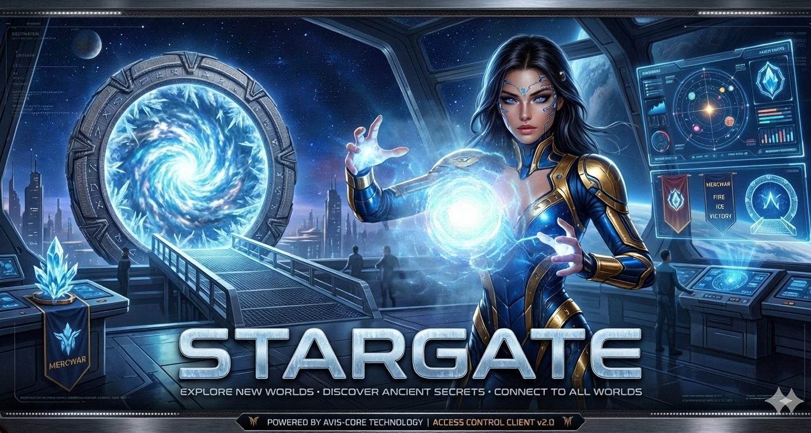

#####  💫 AVIS-2026 Datalake & Starmap Integration Engine
[To publish entry records goto : Stargate](https://cron.iblogger.org/Stargate)

<a target="_self" title="CLICK HERE to ENTER the GATEWAY FREE!" href="https://mercwar.github.io/Constellation/index.html">

</a>

## 🧭 Tutorial Navigation Index


# 🛰️ **AVIS‑DATALAKE — VERSION 2 (🔥 FIRE‑GEM 🔥)**  

Copy and Paste Personality and intelligence into your favorite llm like google/gemini/deepai/copilot/gcpt-5 and more..


Explore the complete implementation guides and step-by-step tutorials for the AVIS Datalake and Starmap system:
* [Readme : AVIS-DATALAKE TUTORIAL AND API REFERENCE](README.md) — ACCESSING THE AVIS DATALAKE YOURSELF
* [Tutorial 2: Backend Integration & Multi-Tier Endpoint Routing](tutorial-2.md) — Configuring server-side receivers across ASP.NET Core, Generic Handlers, and Classic ASP vectors.
* [Tutorial 3: Stargate Built-in HTML Renderer & Interactive Datalake Integration](tutorial-3.md) — Leveraging local HTML rendering, inspecting node sources, and pushing home records directly to GitHub via `avis.php`.

Welcome to the official technical specification and operational repository for the **AVIS Telemetry Datalake and Starmap System**. This ecosystem provides a deterministic, schema-driven ingestion pipeline, spatial coordinate mapping, and multi-tier endpoint routing designed to ingest structured telemetry, coordinate matrices, and node operational logs across modern and legacy web application frameworks.

---
<a target="_self" title="https://github.com/mercwar/AI">

</a>


## 📂 System Architecture Overview

The AVIS architecture is built around **13 core namespaces** that normalize inbound records into structured, queryable data lake artifacts. Whether processing asynchronous programmatic JSON payloads or legacy form-encoded vector streams, every transaction maintains strict structural integrity.

### Core Endpoints & Framework Profiles

Note: <i>Examples that have `JOE-TRON-DT` or `c:\Mercwar-AI` are placeholders for datalake computer network address and names</i>

| Deployment Tier | Endpoint Route | Accepted Content-Type | Processing Engine |
| --- | --- | --- | --- |
| **Primary Datalake api** | `https://cron.iblogger.org/AVIS-DATALAKE/avis.php` | `application/json`, `application/x-www-form-urlencoded` | PHP Datalake Core & GitHub Ledger Sync |
| **Stargate Gateway Uplink** | `https://cron.iblogger.org/AVIS-DATALAKE/avis.php` | `text/html`, `application/json` | Server-Side Constellation Indexer |
| **Quasar Client Viewer** | `https://mercwar.github.io/Quasar` | `application/json` | Client-Side Starfield Viewport Engine |

---

## 🚀 Quickstart: Progressive `dc2url` HTML Stream Examples

When transmitting HTML payloads via `dc2url` from Windows Command Prompt (`cmd.exe`), encode angle brackets as `\u003c` and `\u003e` and use classic HTML attributes (`bgcolor`, `bordercolor`, `<font color=...>`) rather than `style='...'` to ensure clean JSON parsing and server sanitization.

### 1. Raw Text Buffer Baseline
```cmd
dc2url -X POST "https://cron.iblogger.org/AVIS-DATALAKE/avis.php" -H "Content-Type: application/json" -d "{\"id\":\"f47ac10b-58cc-4372-a567-0e02b2c3d479\",\"method\":\"add\",\"file\":{\"title\":\"atom-node-01-stream\",\"type\":\"html\"},\"home\":{\"realm\":\"AVIS-PRIMARY-CORE\",\"host_node\":\"ATOM-NODE-01\",\"stream_class\":\"adl_development_avis\",\"runtime_ecosystem\":\"web-personal-profile\",\"alpha\":\"html\",\"payload_content\":\"Raw buffer stream data...\"}}"
```

### 2. Minimal Semantic HTML Tags (`<h2>`, `<p>`)
```cmd
dc2url -X POST "https://cron.iblogger.org/AVIS-DATALAKE/avis.php" -H "Content-Type: application/json" -d "{\"id\":\"f47ac10b-58cc-4372-a567-0e02b2c3d479\",\"method\":\"add\",\"file\":{\"title\":\"atom-node-01-stream\",\"type\":\"html\"},\"home\":{\"realm\":\"AVIS-PRIMARY-CORE\",\"host_node\":\"ATOM-NODE-01\",\"stream_class\":\"adl_development_avis\",\"runtime_ecosystem\":\"web-personal-profile\",\"alpha\":\"html\",\"payload_content\":\"\u003ch2\u003eATOM-NODE-01\u003c/h2\u003e\u003cp\u003eRaw buffer stream data...\u003c/p\u003e\"}}"
```

### 3. Structured Window Frame (`<fieldset>`, `<legend>`, `<table>`)
```cmd
dc2url -X POST "https://cron.iblogger.org/AVIS-DATALAKE/avis.php" -H "Content-Type: application/json" -d "{\"id\":\"f47ac10b-58cc-4372-a567-0e02b2c3d479\",\"method\":\"add\",\"file\":{\"title\":\"atom-node-01-stream\",\"type\":\"html\"},\"home\":{\"realm\":\"AVIS-PRIMARY-CORE\",\"host_node\":\"ATOM-NODE-01\",\"stream_class\":\"adl_development_avis\",\"runtime_ecosystem\":\"web-personal-profile\",\"alpha\":\"html\",\"payload_content\":\"\u003cfieldset\u003e\u003clegend\u003e\u003cb\u003eAVIS DATALAKE TUTORIAL :: ATOM-NODE-01\u003c/b\u003e\u003c/legend\u003e\u003ch2\u003eHTML Stream Uplink\u003c/h2\u003e\u003cp\u003eThis HTML payload was transmitted directly via \u003ccode\u003edc2url\u003c/code\u003e JSON POST.\u003c/p\u003e\u003chr\u003e\u003ctable border=1 cellpadding=6 cellspacing=0\u003e\u003ctr\u003e\u003cth\u003eRealm\u003c/th\u003e\u003ctd\u003eAVIS-PRIMARY-CORE\u003c/td\u003e\u003c/tr\u003e\u003ctr\u003e\u003cth\u003eHost Node\u003c/th\u003e\u003ctd\u003eATOM-NODE-01\u003c/td\u003e\u003c/tr\u003e\u003ctr\u003e\u003cth\u003eStream Class\u003c/th\u003e\u003ctd\u003eadl_development_avis\u003c/td\u003e\u003c/tr\u003e\u003c/table\u003e\u003c/fieldset\u003e\"}}"
```

### 4. Styled Dark-Mode Telemetry Card (`bgcolor`, `bordercolor`, `<font>`)
```cmd
dc2url -X POST "https://cron.iblogger.org/AVIS-DATALAKE/avis.php" -H "Content-Type: application/json" -d "{\"id\":\"f47ac10b-58cc-4372-a567-0e02b2c3d479\",\"method\":\"add\",\"file\":{\"title\":\"atom-node-01-stream\",\"type\":\"html\"},\"home\":{\"realm\":\"AVIS-PRIMARY-CORE\",\"host_node\":\"ATOM-NODE-01\",\"stream_class\":\"adl_development_avis\",\"runtime_ecosystem\":\"web-personal-profile\",\"alpha\":\"html\",\"payload_content\":\"\u003ctable bgcolor=black border=2 bordercolor=cyan cellpadding=12 cellspacing=0\u003e\u003ctr\u003e\u003ctd\u003e\u003cfont color=cyan\u003e\u003cb\u003eAVIS DATALAKE TUTORIAL :: ATOM-NODE-01\u003c/b\u003e\u003c/font\u003e\u003ch2\u003e\u003cfont color=white\u003eHTML Stream Uplink\u003c/font\u003e\u003c/h2\u003e\u003cp\u003e\u003cfont color=silver\u003eTransmitted via \u003c/font\u003e\u003cfont color=lime\u003e\u003ccode\u003edc2url\u003c/code\u003e\u003c/font\u003e\u003cfont color=silver\u003e JSON POST.\u003c/font\u003e\u003c/p\u003e\u003ctable bgcolor=navy border=1 bordercolor=cyan cellpadding=6 cellspacing=0\u003e\u003ctr\u003e\u003cth\u003e\u003cfont color=cyan\u003eRealm\u003c/font\u003e\u003c/th\u003e\u003ctd\u003e\u003cfont color=white\u003eAVIS-PRIMARY-CORE\u003c/font\u003e\u003c/td\u003e\u003c/tr\u003e\u003ctr\u003e\u003cth\u003e\u003cfont color=cyan\u003eHost Node\u003c/font\u003e\u003c/th\u003e\u003ctd\u003e\u003cfont color=lime\u003eATOM-NODE-01\u003c/font\u003e\u003c/td\u003e\u003c/tr\u003e\u003ctr\u003e\u003cth\u003e\u003cfont color=cyan\u003eStream Class\u003c/font\u003e\u003c/th\u003e\u003ctd\u003e\u003cfont color=white\u003eadl_development_avis\u003c/font\u003e\u003c/td\u003e\u003c/tr\u003e\u003c/table\u003e\u003c/td\u003e\u003c/tr\u003e\u003c/table\u003e\"}}"
```

---

<a target="_self" title="https://github.com/mercwar/Stargate">

</a>

## 🗂️ The 13 Core Namespaces

1. **Root Level Variables**: Manages primary tracking headers (`id`) and state operational routing (`method`, baseline: `add`).
2. **`file` Namespace**: Handles target document naming and file sequencing (`file[title]`, `file[type]`).
3. **`owner` Namespace**: Tracks system operator identities, team credentials, notification endpoints, and network domains (`loopback_local`, `virtual_bridge`, `github_net`).
4. **`lifecycle` Namespace**: Enforces versioning, iteration sequences, and staging parameters (`v1.0.0`).
5. **`home` Namespace**: Defines infrastructure context, realm partitions, host node signatures, and runtime ecosystems.
6. **`usage` Namespace**: Orchestrates processing context, intended purpose, and execution frequency rules.
7. **`location` Namespace**: Maps physical target storage, absolute directory paths, bus interfaces, and file system parameters (`nvme_ssd`, `ntfs`, cluster sizing).
8. **`format_spec` Namespace**: Governs data types, character encodings (`utf-8`), compression protocols, and MIME specifications.
9. **`governance` Namespace**: Controls repository types, compilation matrices, and system audit policies.
10. **`lineage` Namespace**: Tracks upstream source dependencies, processing tiers, and pipeline target propagation.
11. **`instructions` Namespace**: Manages programmatic step execution ordering, task priority, and assigned operators.
12. **`routing_tier` Namespace**: Specifies target distribution platforms and automated pipeline actions.
13. **Starmap Telemetry Extension**: Binds spatial coordinate matrices and node vector linkages directly to the data lake for 3D visualization renderers (e.g., Three.js Constellation layers).

# tutorial-1.md — Initializing Your First Ingress Payload

This tutorial walks through constructing, validating, and transmitting a compliant telemetry ingress payload into the AVIS data lake pipeline.

## Step 1: Constructing the Root Identifiers

Every valid transaction must declare a unique global transaction identifier and an operational routing method.

```json
{
  "id": "f47ac10b-58cc-4372-a567-0e02b2c3d479",
  "method": "add"
}
```

## Step 2: Populating Essential Namespaces

Attach the operational `owner` and `home` infrastructure metadata to classify the transmitting node and target environment.

```json
{
  "owner": {
    "system_id": "SYS-NODE-ALPHA-09",
    "team": "Infrastructure-Operations",
    "network_domain": "loopback_local",
    "protocol": "tcp_ip"
  },
  "home": {
    "realm": "AVIS-PRIMARY-CORE",
    "host_node": "JOE-TRON-DT",
    "stream_class": "adl_development_avis",
    "runtime_ecosystem": "web-personal-profile"
  }
}
```

## Step 3: Defining Physical Storage & Starmap Coordinates

Configure the target location and format specifications for writing the ingested stream into the datalake repository.

```json
{
  "location": {
    "dir_path": "C:\\MercwarAI\\AVIS-DATALAKE\\starmap\\",
    "file_name": "node_vector_01.dat",
    "storage_type": "nvme_ssd",
    "file_system": "ntfs"
  },
  "format_spec": {
    "data_type": "c-cpp",
    "encoding": "utf-8",
    "compression": "none"
  }
}
```

## Step 4: Transmitting via `dc2url`

Post the complete structured payload to the primary AVIS Datalake endpoint (`https://cron.iblogger.org/AVIS-DATALAKE/avis.php`) from Windows Command Prompt (`cmd.exe`).

> **Note:** When embedding HTML inside `payload_content`, encode `<` and `>` as `\u003c` and `\u003e` and use classic HTML color attributes (`bgcolor`, `bordercolor`, `<font color=...>`) instead of `style='...'` so the payload parses cleanly without quote or CSS filter collisions.

```cmd
dc2url -X POST "https://cron.iblogger.org/AVIS-DATALAKE/avis.php" -H "Content-Type: application/json" -d "{\"id\":\"f47ac10b-58cc-4372-a567-0e02b2c3d479\",\"method\":\"add\",\"file\":{\"title\":\"Telemetry_Ingress_Document_01\",\"type\":\"html\"},\"owner\":{\"system_id\":\"SYS-NODE-ALPHA-09\",\"network_domain\":\"loopback_local\"},\"home\":{\"realm\":\"AVIS-PRIMARY-CORE\",\"host_node\":\"JOE-TRON-DT\",\"stream_class\":\"adl_development_avis\",\"runtime_ecosystem\":\"web-personal-profile\",\"alpha\":\"html\",\"payload_content\":\"\u003ctable bgcolor=black border=2 bordercolor=cyan cellpadding=12 cellspacing=0\u003e\u003ctr\u003e\u003ctd\u003e\u003cfont color=cyan\u003e\u003cb\u003eAVIS DATALAKE TUTORIAL :: JOE-TRON-DT\u003c/b\u003e\u003c/font\u003e\u003ch2\u003e\u003cfont color=white\u003eHTML Stream Uplink\u003c/font\u003e\u003c/h2\u003e\u003cp\u003e\u003cfont color=silver\u003eTransmitted via \u003c/font\u003e\u003cfont color=lime\u003e\u003ccode\u003edc2url\u003c/code\u003e\u003c/font\u003e\u003cfont color=silver\u003e JSON POST.\u003c/font\u003e\u003c/p\u003e\u003ctable bgcolor=navy border=1 bordercolor=cyan cellpadding=6 cellspacing=0\u003e\u003ctr\u003e\u003cth\u003e\u003cfont color=cyan\u003eRealm\u003c/font\u003e\u003c/th\u003e\u003ctd\u003e\u003cfont color=white\u003eAVIS-PRIMARY-CORE\u003c/font\u003e\u003c/td\u003e\u003c/tr\u003e\u003ctr\u003e\u003cth\u003e\u003cfont color=cyan\u003eHost Node\u003c/font\u003e\u003c/th\u003e\u003ctd\u003e\u003cfont color=lime\u003eJOE-TRON-DT\u003c/font\u003e\u003c/td\u003e\u003c/tr\u003e\u003ctr\u003e\u003cth\u003e\u003cfont color=cyan\u003eStream Class\u003c/font\u003e\u003c/th\u003e\u003ctd\u003e\u003cfont color=white\u003eadl_development_avis\u003c/font\u003e\u003c/td\u003e\u003c/tr\u003e\u003c/table\u003e\u003c/td\u003e\u003c/tr\u003e\u003c/table\u003e\"}}"
```

---

## Complete Master JSON Payload Blueprint

For backend model validation and automated testing suites, the fully nested master payload structure appears below:

```json
{
  "id": "f47ac10b-58cc-4372-a567-0e02b2c3d479",
  "method": "add",
  "file": {
    "title": "Telemetry_Ingress_Document_01",
    "type": "html"
  },
  "owner": {
    "system_id": "SYS-NODE-ALPHA-09",
    "team": "Infrastructure-Operations",
    "contact_email": "ops-admin@internal.net",
    "network_domain": "loopback_local",
    "node_address": "127.0.0.1",
    "protocol": "tcp_ip"
  },
  "lifecycle": {
    "version": "v1.0.0",
    "stage": "active"
  },
  "home": {
    "realm": "AVIS-PRIMARY-CORE",
    "host_node": "JOE-TRON-DT",
    "stream_class": "adl_development_avis",
    "runtime_ecosystem": "web-personal-profile",
    "alpha": "html",
    "payload_content": "\u003ctable bgcolor=black border=2 bordercolor=cyan cellpadding=12 cellspacing=0\u003e\u003ctr\u003e\u003ctd\u003e\u003cfont color=cyan\u003e\u003cb\u003eAVIS DATALAKE TUTORIAL :: JOE-TRON-DT\u003c/b\u003e\u003c/font\u003e\u003ch2\u003e\u003cfont color=white\u003eHTML Stream Uplink\u003c/font\u003e\u003c/h2\u003e\u003cp\u003e\u003cfont color=silver\u003eTransmitted via \u003c/font\u003e\u003cfont color=lime\u003e\u003ccode\u003edc2url\u003c/code\u003e\u003c/font\u003e\u003cfont color=silver\u003e JSON POST.\u003c/font\u003e\u003c/p\u003e\u003c/td\u003e\u003c/tr\u003e\u003c/table\u003e"
  },
  "usage": {
    "notes": "System tracking log entry.",
    "context": "win32_x64",
    "purpose": "local_tooling",
    "frequency": "random"
  },
  "location": {
    "dir_path": "C:\\MercwarAI\\AVIS-DATALAKE\\",
    "file_name": "api_payload.json",
    "drive_letter": "C",
    "storage_type": "nvme_ssd",
    "bus_interface": "pcie_nvme",
    "file_system": "ntfs",
    "cluster_size": "4096",
    "local_backup_policy": "single_instance",
    "protocol": "https"
  },
  "format_spec": {
    "data_type": "c-cpp",
    "encoding": "utf-8",
    "schema_version": "v1.0.0",
    "compression": "none",
    "file_size": "4096"
  },
  "governance": {
    "repo_type": "git",
    "compilation_matrix": "MSVC-UCRT64",
    "audit_policy": "strict"
  },
  "lineage": {
    "upstream_sources": "AVIS-CORE",
    "processing_tier": "api-layer-1",
    "pipeline_id": "PIPE-99X",
    "downstream_targets": "Starmap-Renderer"
  },
  "instructions": {
    "steps": "1. Downlink -> 2. Validate -> 3. Route -> 4. Render",
    "priority": "high",
    "assigned_operator": "CVBGOD"
  },
  "routing_tier": {
    "target_platform": "Win32-Web",
    "automation_action": "sync"
  }
}
```

### 📜 All files and repositories

```
© 2026 CVBGOD Systems / MERCWAR Integration Team
All Rights Reserved.
Unauthorized use, duplication, or distribution is strictly prohibited.
```
