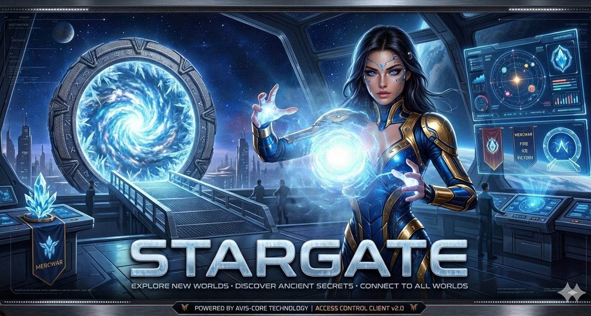

# tutorial-2.md — Backend Integration & Multi-Tier Endpoint Routing
[To publish entry records goto : Stargate](https://github.com/mercwar/Stargate)


## 🧭 Tutorial Navigation Index

Explore the complete implementation guides and step-by-step tutorials for the AVIS Datalake and Starmap system:
* [Readme : AVIS-DATALAKE TUTORIAL AND API REFERENCE](README.md) — ACCESSING THE AVIS DATALAKE YOURSELF
* [Tutorial 1: Initializing Your First Record](tutorial-1.md) — Constructing, validating, and submitting your initial structured data payloads.
* [Tutorial 2: Backend Integration & Multi-Tier Endpoint Routing](tutorial-2.md) — Configuring server-side receivers across ASP.NET Core, Generic Handlers, and Classic ASP vectors.
* [Tutorial 3: Stargate Built-in HTML Renderer & Interactive Datalake Integration](tutorial-3.md) — Leveraging local HTML rendering, inspecting node sources, and pushing home records directly to GitHub via `avis.php`.


<a target="_self" title="https://github.com/mercwar/AI">

</a>

---

To explaine now in deatail ...

Using a command line you submit a record to the avis-dl, the record is saves in a github pages artifact as normally it would be.
The listing is github/mercwar and its cron.iblogger.org that services this host. So you now have the ability to upload for your users to 
the avis datalake and here is how. 

- You users click on a simple html page in the avis datalake , through NEXUS, or another link .
- Your html/javascript form will post to the avis datalake by way of your local server or dc2url or Stargate entry.
- Stargate entry means you have an access point now to host file i.o requests.
- Now that your user is on the stargate page and has opened the html overhead content you see that your javascript is what is running now
- Because the javascript is running on that server even though it has been loaded from git hub, this `avis.php` file will now function.
- Your users will smbit data to you to be stored in datalake records.
- Example: [Here](https://mercwar.github.io/AVIS-DL/dl%2F2026%2F11%2F19%2F9-atom-node-01-stream.html)
- This example can be submitted with dc2url or through the avis datalake or your own Stargate entry
---

<a target="_self" title="https://github.com/mercwar/Stargate">

</a>
[To publish entry records goto : Stargate](https://github.com/mercwar/Stargate)


## 🧭 Tutorial Navigation Index

Explore the complete implementation guides and step-by-step tutorials for the AVIS Datalake and Starmap system:
* [Readme : AVIS-DATALAKE TUTORIAL AND API REFERENCE](README.md) — ACCESSING THE AVIS DATALAKE YOURSELF
* [Tutorial 1: Initializing Your First Record](tutorial-1.md) — Constructing, validating, and submitting your initial structured data payloads.
* [Tutorial 2: Backend Integration & Multi-Tier Endpoint Routing](tutorial-2.md) — Configuring server-side receivers across ASP.NET Core, Generic Handlers, and Classic ASP vectors.
* [Tutorial 3: Stargate Built-in HTML Renderer & Interactive Datalake Integration](tutorial-3.md) — Leveraging local HTML rendering, inspecting node sources, and pushing home records directly to GitHub via `avis.php`.

### 📜 All files and repositories

```
© 2026 CVBGOD Systems / MERCWAR Integration Team
All Rights Reserved.
Unauthorized use, duplication, or distribution is strictly prohibited.
```
